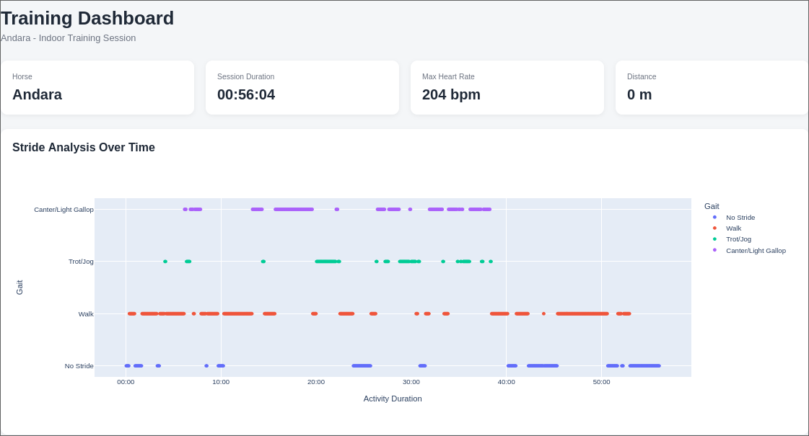
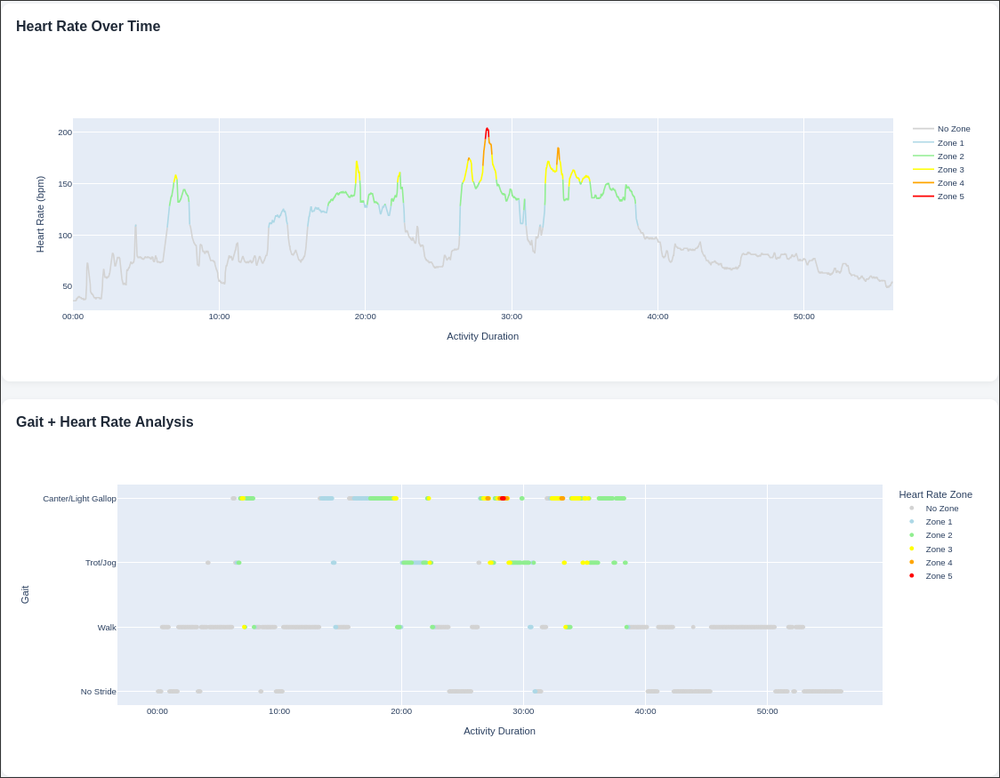
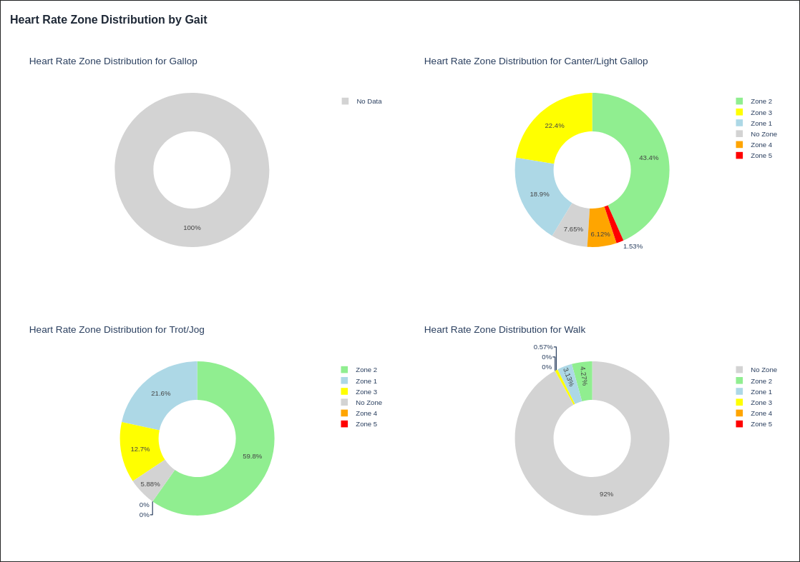

# Bonfire — Equine Training Insights 🔥🐎

**An independent Python dashboard for deeper analysis and visualization of equine training data exported from Garmin Blaze.**

> 🚧 **Work in Progress** — Bonfire is an ongoing personal data analytics project. The current version provides initial visualizations of heart rate, stride patterns, gait, and training intensity. Features and functionality are still being developed.

## About the Project

Garmin Blaze provides data about equine training sessions. Bonfire explores how these exported measurements can be visualized and analyzed in more detail, helping uncover relationships between different aspects of a horse's training.

Rather than replacing the existing Garmin application, Bonfire aims to provide an additional analytical perspective through interactive visualizations and comparisons between heart rate, stride patterns, and gait.

The dashboard is built with **Python, Dash, Plotly, and Pandas** and runs locally on your computer.

## Current Features

The current implementation includes:

* **Training overview** — Displays the horse's name, activity type, session duration, maximum heart rate, and distance.
* **Stride and gait analysis** — Visualizes gait patterns over the course of a training session.
* **Heart rate analysis** — Displays heart rate over time, with line colors representing different heart rate zones.
* **Heart rate and gait comparison** — Colors individual gait observations according to the corresponding heart rate zone to explore the relationship between gait and training intensity.
* **Heart rate zone distribution by gait** — Uses donut charts to summarize the distribution of heart rate zones for each gait category.
* **Session data table** — Provides an interactive table of stride-related observations, with sorting and filtering.

## Preview

*Additional Screenshots of the dashboard will be added here as development progresses.*






## Technology Stack

| Technology   | Purpose                                    |
| ------------ | ------------------------------------------ |
| Python       | Data processing and application logic      |
| Pandas       | Data loading, transformation, and analysis |
| Plotly       | Interactive data visualizations            |
| Dash         | Interactive web dashboard                  |
| Dash AG Grid | Tabular data exploration                   |
| HTML and CSS | Dashboard layout and styling               |

## Getting Started

### Prerequisites

* Python 3.10 or newer recommended
* pip
* A compatible CSV export from Garmin Blaze

### 1. Clone the repository

```bash
git clone https://github.com/YOUR-USERNAME/bonfire-equine-insights.git
cd bonfire-equine-insights
```

Replace `YOUR-USERNAME` with your GitHub username.

### 2. Create a virtual environment

```bash
python -m venv .venv
```

Activate it:

**Windows**

```bash
.venv\Scripts\activate
```

**macOS / Linux**

```bash
source .venv/bin/activate
```

### 3. Install dependencies

```bash
pip install dash dash-ag-grid pandas plotly
```

### 4. Prepare the data

Place a compatible CSV file at:

```text
data/TimeSeriesData.csv
```

The current implementation reads this file directly when the application starts. The dataset must contain the expected columns and follow the data structure used by the application.

### 5. Run the dashboard

```bash
python app.py
```

Open the local URL printed in the terminal, typically `http://127.0.0.1:8050`.

## Project Structure

```text
bonfire-equine-insights/
├── app.py
├── info.py
├── README.md
├── assets/
│   └── style.css
└── data/
    └── TimeSeriesData.csv
```

* `app.py` — Loads and processes the session data, creates visualizations, and defines the Dash layout.
* `assets/style.css` — Defines the dashboard's appearance.
* `data/TimeSeriesData.csv` — Sample input data used by the current implementation.

## Current Scope and Limitations

Bonfire is designed specifically for **CSV data exported from Garmin Blaze that matches the expected data structure**. It is not currently a general-purpose equine data analysis tool.

* The application currently loads a predefined CSV file rather than allowing users to upload their own files through the dashboard.
* Heart rate zones are calculated using a value defined in the Python source code; there is not yet an interface for changing the horse's maximum heart rate.
* Stride and gait analysis depends on the availability and structure of the exported stride-count measurements.
* GPS-based analysis is not currently a primary feature.
* The dashboard has not yet been extensively tested against different horses, activities, or export variations.

The visualizations are intended for exploratory analysis and should not be interpreted as veterinary advice or a validated assessment of equine fitness.

## Roadmap

The project is actively evolving. Planned improvements include:

* [ ] **CSV upload** — Allow users to select a compatible export file and update the dashboard dynamically.
* [ ] **Improved visualizations** — Refine chart layouts, hover information, legends, and presentation.
* [ ] **Configurable heart rate zones** — Allow users to adjust the maximum heart rate used for zone calculations.
* [ ] **Multi-session analysis** — Support selecting a folder of training sessions and comparing averages, trends, and session-level statistics.
* [ ] **Single-session and multi-session modes** — Let users choose between detailed analysis of one session and aggregated analysis across multiple sessions.
* [ ] **GPS exploration** — Investigate location and route visualizations where GPS data are available.
* [ ] **Improved input validation** — Provide clear feedback when input files do not match the expected format.
* [ ] **Code refactoring and testing** — Separate data processing from visualization logic and improve robustness.

## Motivation

This project is an opportunity to explore how data analysis and interactive visualization can provide additional insights into equine training data.

The main focus is not simply displaying individual measurements, but examining relationships between them—for example, how heart rate zones are distributed across different gaits and how training intensity changes throughout a session.

## Disclaimer

Bonfire is an independent, unofficial project. It is not affiliated with, endorsed by, or sponsored by Garmin Ltd. Garmin and Blaze are referenced solely to identify the source and compatibility of the exported data.

## Status

**Active development — contributions, feedback, and suggestions are welcome.**
